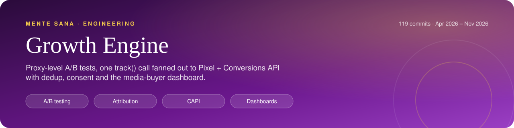
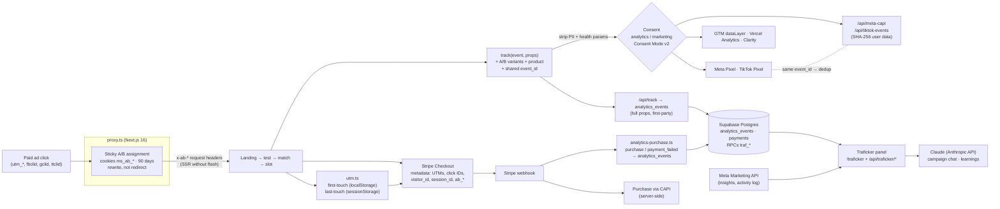

     

<h1 align="center">Mente Sana Growth Engine</h1>
<!-- /header -->

Experimentation, attribution and conversion tracking for a paid-acquisition funnel in online mental health, plus the internal dashboard the media buyer uses to run it.

Extracted from the production Next.js 16 codebase of [Mente Sana](https://mentesanapsicologia.com), an online psychology clinic in Spain with 8,000+ patients and 150+ licensed psychologists. The git history is the real one: 118 commits from April to October 2026.

---

## At a glance

<table>
  <tr>
    <td align="center" width="25%"><b>Experimentation &amp; measurement owner</b> Role</td>
    <td align="center" width="25%"><b>Sticky cookie variants at the proxy</b> Experiments</td>
    <td align="center" width="25%"><b>Pixel + CAPI, deterministic event_id</b> Tracking</td>
    <td align="center" width="25%"><b>Closed a 0-purchase pixel gap server-side</b> Result</td>
  </tr>
</table>

## The problem

Mente Sana gets most of its new patients through a **€9.99 diagnostic session**: a paid ad leads to a landing page, then a short test, a matched psychologist, a time slot and a Stripe checkout. Paying for that first step is what later leads people to buy a therapy bundle.

Three things made this funnel hard to run well:

- **No reliable measurement.** Payment completes on Stripe's domain, so the browser never sees the purchase. UTMs disappeared during SPA navigation and redirects, so most events were recorded as "direct". Meta also treats a mental-health site as a restricted health dataset and quietly drops standard events such as Lead and Purchase from the browser pixel.
- **No safe way to experiment.** Changes went live for everyone, so nobody could tell whether a new landing page or checkout flow helped or hurt.
- **The media buyer was working blind.** Ads Manager reported pixel "conversions", not verified sales or the patient's lifetime value, and every time the agency or buyer changed, what they had learned was lost.

## What I built

- **Edge A/B testing in `proxy.ts`.** Variants are assigned per cookie and stay sticky for 90 days. The proxy serves them as rewrites, never redirects, and passes them to server rendering in request headers so pages render without a flash. QA can force any variant with a query param (`?landing=`, `?flujo=`, `?pantalla=`, `?warming=`). Five tests ran across the landing, test, match and payment steps.
- **One `track()` call fans out to every destination.** Each call writes to the internal `analytics_events` table and also sends the event to the Meta Pixel, Meta Conversions API, TikTok Pixel, TikTok Events API, the GTM `dataLayer`, Vercel Analytics and Microsoft Clarity. Every event carries the active A/B variants and the funnel product.
- **Event dedup across browser and server.** The pixel and CAPI receive the same `event_id`. Leads use a deterministic ID (`lead_` plus a SHA-256 of the email), so the browser pixel, the CAPI call from the browser and the CAPI call from the server count as a single Lead.
- **Health-safe payloads.** PII and health parameters (profile, symptom, score, psychologist and so on) are removed before anything goes to ad platforms. They stay only in first-party analytics. A single event map, `meta-events.ts`, is shared by client and server so event names match on both sides and Meta's dedup works.
- **First-touch and last-touch attribution.** The original paid touch persists across sessions and the latest visit is tracked per session. Click IDs (gclid, fbclid, ttclid, msclkid) are kept for the length of ad attribution windows. All of it is written into Stripe metadata.
- **Server-side purchase events.** The Stripe webhook writes `purchase` and `payment_failed` to `analytics_events` with the browser's `visitor_id` and `session_id`, which made the round trip through Stripe metadata. That lets a payment join the rest of the funnel, from test to paid, split by A/B variant.
- **Consent that holds up to GDPR and AEPD rules.** The cookie banner is prior, granular and revocable. Google Consent Mode v2 defaults to denied and updates when the user decides. Analytics and marketing are gated separately. One hostname-scoped exception covers campaign domains, documented with its compliance caveat.
- **The traficker (media buyer) panel.** It has OTP email login and over 15 tabs:
  - campaign → ad set → ad drill-down and winners by funnel
  - €9.99 sales, comparing what Meta reports with UTM-verified sales, plus CAC per campaign and blended ROAS
  - leads per funnel and bundle revenue by original funnel (SQL RPCs)
  - lead efficacy as a cohort funnel: captured → attended → sold
  - an app metrics block
  - a chat that analyses campaigns using the last 30 days of ad data
  - a "Learnings" tab that rebuilds the ad account's history as eras of each media buyer, detects them from CPA breaks, attributes each era to the real operator via the Graph API activity log, and summarises what worked
- **A clinical-insights advisor.** The model can only call tools that return aggregate counts with k-anonymity (`MIN_GROUP = 10`). It never sees raw rows, SQL or patient identifiers.

## Screenshots

  
  

Variant: explainer landing · Variant: pain-angle landing

## Architecture

## Key decisions & trade-offs

- **Rewrite, never redirect, for experiments and paid traffic.** An earlier proxy rule sent paid visitors with a 307 to a social-proof landing. It was removed after it turned out the redirect dropped the `fbclid` and broke pixel attribution, so the ads were optimising on bad data. A/B variants are now served by `NextResponse.rewrite`, so the URL and click IDs stay unchanged. The variant reaches SSR through a request header, because on a first visit the cookie hasn't arrived yet.
- **One event map shared by client and server.** When the pixel mapped an event to a standard name and CAPI sent it as custom, Meta couldn't dedup the pair. `meta-events.ts` is now the single source of truth. A related rule came out of an audit in August: only the step that actually opens the payment gateway may send `InitiateCheckout`. Before, starting a questionnaire also sent it, so Meta saw 522 InitiateCheckout events a week against about 147 real ones and optimised toward people who start tests rather than people who pay.
- **Working within Meta's health-data restrictions.** Meta drops Lead, Purchase, Schedule and, as of 21 September 2026, Contact from the browser for this dataset. The response:
  - remove every health parameter before events reach any ad platform
  - send conversions from the server through CAPI
  - also emit a custom `email_capturado` event (custom events always get through) so campaigns have something they can optimise on
- **Server-side purchases as the source of truth.** The purchase happens on Stripe's domain, so a client-side `purchase` event never fires. The pipeline sends `visitor_id` and `session_id` to Stripe metadata, and the webhook writes the row back. The trade-off is that older checkouts that don't send those IDs produce rows that can't be joined. The code keeps those rows anyway, because an unjoined row is better than a missing one.
- **Close tests in code, but keep the instrumentation.** When a test is decided, the winner gets 100% of traffic, but the cookie, the header and the variant attached to each event stay in place. QA overrides keep working, and historical funnel queries stay consistent.
- **Fail-open versus fail-closed in the panel.** Panel sessions are HMAC-signed cookies valid for 24 hours. After an agency's access was revoked, each request also checks that the account is still active, with a 60-second cache. If the database doesn't respond, the check lets the request through. That is a deliberate availability-over-strictness choice for an internal tool. Separately, bundle revenue by funnel is derived live in SQL: the oldest acquisition signal per email decides the funnel. That avoids maintaining an attribution table, at the cost of a large "unknown" bucket that the code comments document.

## Impact

- Built for a clinic serving **8,000+ patients** with **150+ psychologists**. **97% of paid traffic is mobile**, which drove the decisions on SSR without a flash and on a compact cookie banner.
- **A tracking gap found and fixed.** The browser pixel had registered **0 Purchase events**, so Meta had been optimising campaigns toward a conversion it never saw. Purchases moved server-side, through CAPI with deterministic `event_id` dedup.
- **A decision made with data instead of opinion.** From 21 to 28 October 2026, the landing CTA was tested: the test's cover page against jumping straight into question 1. **The cover page won, 8 paid vs 3.** Going straight to question 1 brought about twice as many people into the test but produced fewer payments. The test was closed in favour of the cover page.
- **Lead quality, not just volume.** The efficacy view showed that **85% of buyers attend their session** and **57% buy a therapy bundle within 30 days** (May–September 2026). With that, the media buyer could judge campaigns on revenue rather than on CPA alone.

## Code tour

| Path | What it does |
|---|---|
| `src/proxy.ts` | Next.js 16 proxy: sticky cookie A/B tests, QA overrides, variant headers for SSR, redirect from the `*.vercel.app` alias to the canonical domain |
| `src/lib/tracking.ts` | `track()`: fan-out to internal analytics, Meta Pixel and CAPI, TikTok, GTM, Vercel Analytics and Clarity; shared and deterministic `event_id`; PII and health stripping |
| `src/lib/meta-events.ts` | The single internal → Meta event map, shared by client and server so dedup works |
| `src/lib/utm.ts` | First-touch and last-touch UTM and click-ID capture; merge for Stripe metadata and Payment Links |
| `src/lib/analytics-purchase.ts` | Server-side `purchase` and `payment_failed` rows from the Stripe webhook, joined back to the visitor and session |
| `src/lib/ab-test.ts` | Deterministic client-side A/B on a hash of the visitor ID, with forced winners and a `?ab=` override |
| `src/lib/cookie-consent.ts` | GDPR/AEPD consent record: prior, granular, revocable, with a change event |
| `src/lib/consent-mode.ts` | Google Consent Mode v2: inline default-denied snippet and the update on the user's choice |
| `src/lib/consent-bypass.ts` | Hostname-scoped consent exception for campaign domains |
| `src/app/api/track/route.ts` | Ingests internal analytics events, single or batched |
| `src/app/api/meta-capi/route.ts` | Meta Conversions API relay: SHA-256 user data, IP and UA, product-aware `custom_data`, test event codes |
| `src/app/api/tiktok-events/route.ts` | TikTok Events API relay, deduplicated against the pixel |
| `src/components/TrackingScripts.tsx`, `CookieConsent.tsx`, `UtmTracker.tsx`, `PageViewTracker.tsx` | Consent-gated script loading, the banner, UTM capture and automatic page views |
| `src/lib/traficker-auth.ts` | Panel auth: email OTP, HMAC session cookie, active-account check on each request |
| `src/app/traficker/` | Media buyer panel UI: summary, winners, drill-down, sales, leads, bundles, efficacy, AI and learnings tabs |
| `src/app/api/traficker/sales-999/` | €9.99 sales with UTM attribution, comparing Meta-reported and UTM-confirmed sales, CAC per campaign |
| `src/app/api/traficker/eficacia/` | Cohort funnel by acquisition day: captured → attended → sold |
| `src/app/api/traficker/learnings/` | Account history split into eras by CPA breaks, attributed through the Graph API activity log, summarised by an LLM |
| `src/app/api/traficker/campaign-ai/` | Campaign analysis chat preloaded with 30 days of ad context |
| `src/app/api/traficker/clinical-insights/` | Clinical-insights advisor limited to aggregate, k-anonymous tool calls |
| `supabase/migrations/` | Postgres RPCs: leads per day per funnel, bundle revenue by original funnel (fixed period and date range) |

## Stack

- **App:** Next.js 16 (App Router, `proxy.ts`), React, TypeScript
- **Data:** Supabase (Postgres, SQL RPCs)
- **Payments:** Stripe Checkout and webhooks
- **Ad platforms:** Meta Pixel, Meta Conversions API and Marketing API (Graph v21), TikTok Pixel and Events API
- **Analytics:** Google Tag Manager with Consent Mode v2, Vercel Analytics, Microsoft Clarity
- **LLM features:** Anthropic Messages API
- **Hosting:** Vercel

## About this repo

This is a **read-only extract** of the growth and tracking module from a private production monorepo. The git history is real and has been preserved. Secrets and personal data have been removed. The code **doesn't run on its own**: it imports modules that weren't extracted, such as product config, email, the booking system integration, shared UI and other auth helpers, and it needs the production databases and API credentials. Code comments and commit messages are mostly in Spanish, the team's working language. It's published to show how the system was designed and the reasoning behind it, not as a library.

Author: **Alejandro Álvarez**, CTO at Mente Sana.
